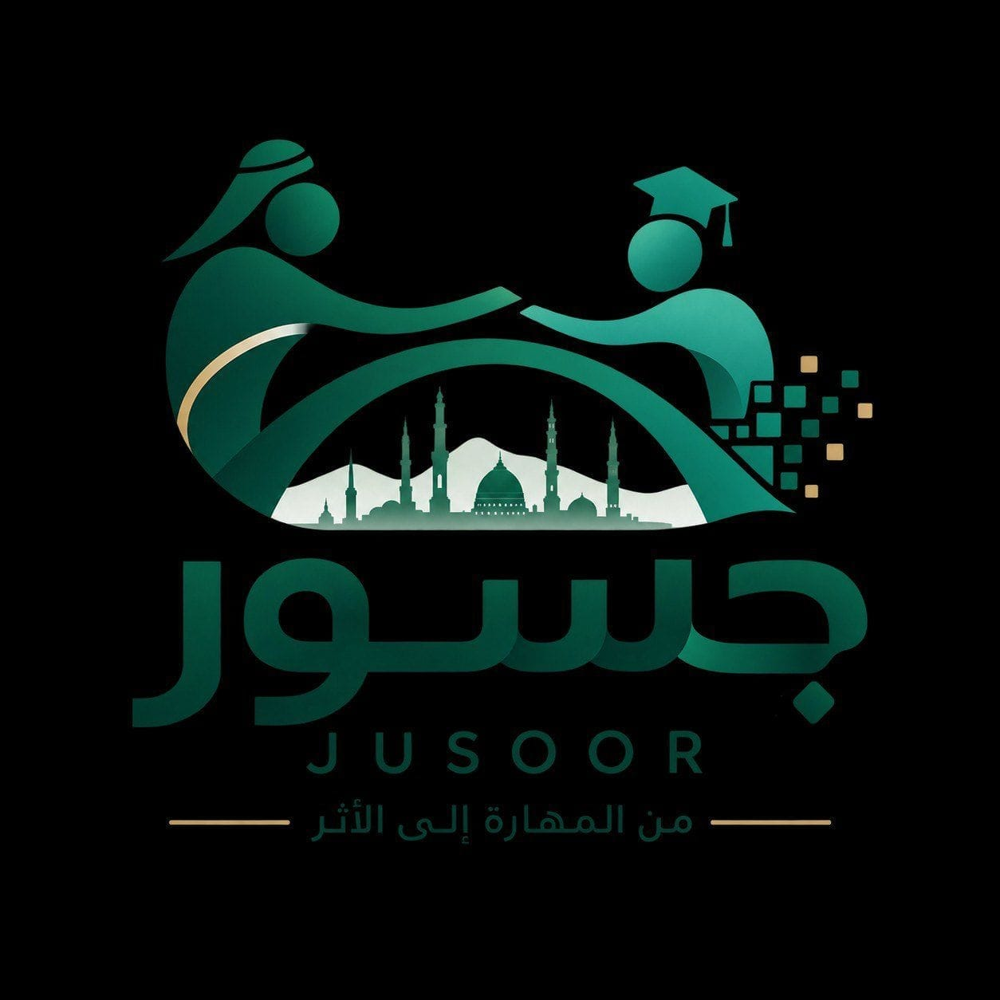
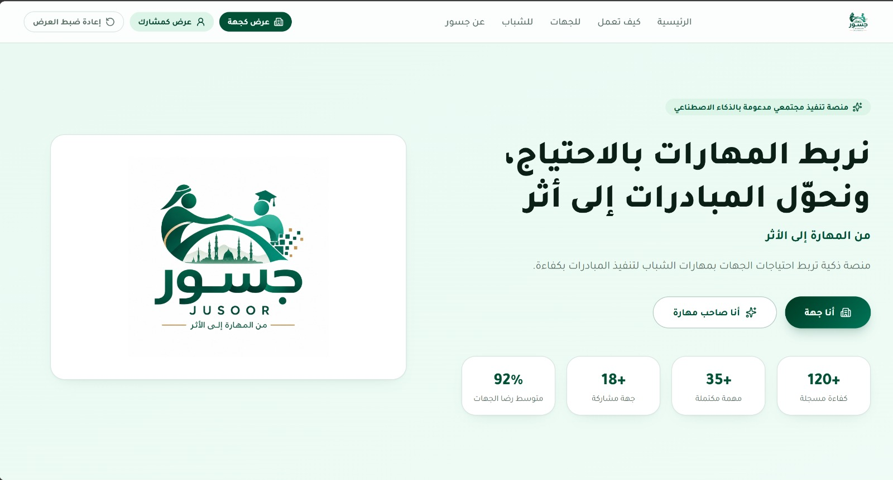
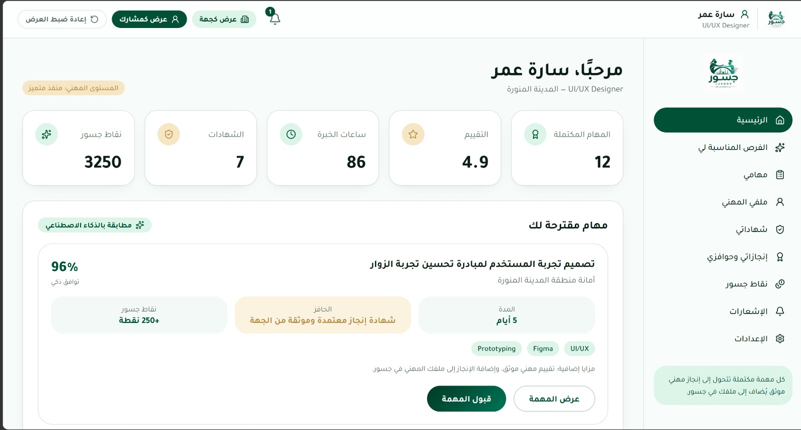

# جسور | Jusoor
### من المهارة إلى الأثر | From skill to impact

**[Live demo](https://jusoor-impact.lovable.app)** | **[Walkthrough video](assets/4-demo.mp4)**

## Overview
Jusoor (جسور, "bridges") is an AI-powered community execution platform. It connects the needs of government and non-profit organizations in Madinah with the skills of young people by breaking large initiatives into micro-tasks and matching each task to the right person.

🏆 **2nd place, Barmajan Al-Madinah 2026 hackathon**, Community Participation track (تفعيل المشاركة المجتمعية). Team 24, a team of five. Awarded 9 September 2026.

## The challenge
**Shortage of skills to carry out community initiatives.**

* **Who faces it:** Government bodies, charities, and young people in Madinah who have skills and want to put them to use.
* **Where:** Service and non-profit organizations inside Madinah.
* **When:** When a community project is launched that needs specific skills such as design or technology.
* **The problem:** Government bodies and non-profits have strong ideas and initiatives, but suffer delays and high execution costs because specialists are missing. Young people have the skills but stay out of community work because there is no documentation or tangible incentive, so their volunteering goes unrecorded. The city loses the chance to carry out its initiatives efficiently.

## The solution
1. **An organization posts a need.** AI analyzes the requirements and splits the project into micro-tasks.
2. **Smart matching** suggests participants whose skills fit each task.
3. **Participants complete tasks** that fit their skills.
4. **Recognition.** Each completed task becomes documented proof of achievement, with points and a rating on the participant's professional profile.

## Two experiences
| For organizations | For skilled participants |
|---|---|
| Post a project or need | See AI-matched suggested tasks |
| Get it split into micro-tasks | Accept tasks that fit your skills |
| Track progress | Earn certificates, points and a rating |

## Screenshots
 

> The numbers and the sample user shown are demo data from the hackathon prototype, not real usage.

## Tech stack
* Prototype built with Lovable, deployed at jusoor-impact.lovable.app
* AI-powered requirement analysis and skill matching

## Team 24
* باسل فالح سليم الزايدي الجهني
* سنا أحمد محمد الصلاحي
* لينه عبدالله سليمان المزيني
* شهد عيسى عبدالعزيز الحجيلي
* العنود بندر محسن الاحمدي

## Author
**Sana Elsalahy** | [LinkedIn](https://www.linkedin.com/in/sana-elsalahy-787bb51ba/) | [GitHub](https://github.com/SanaElsalahy)
